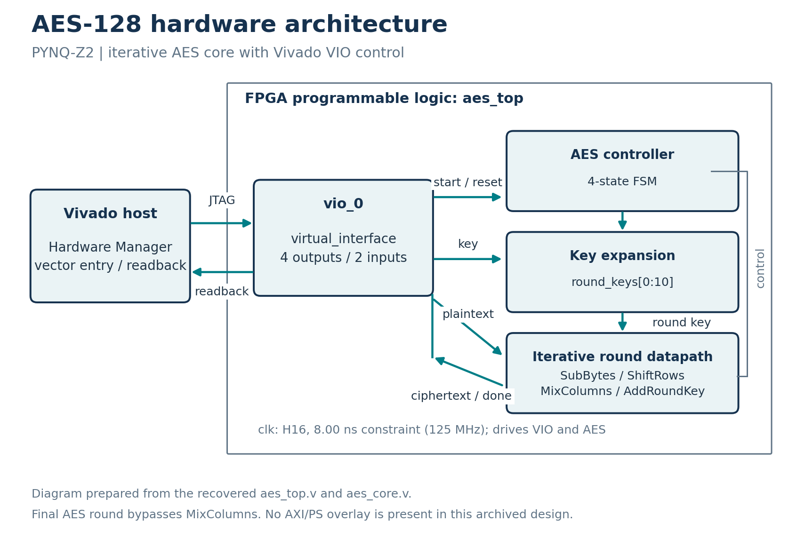

# Experiment 1 — AES-128 Hardware Encryption Accelerator

## Team

**Beyond Boolean**

| Member | Registration Number |
|---|---|
| Shashank Pulipati | 25BEC0573 |
| Kartik Yadav | 25BEC0087 |

## Overview

This project implements an iterative AES-128 encryption accelerator on the PYNQ-Z2 development board. The core accepts a 128-bit key and plaintext through Vivado VIO over JTAG, performs AES encryption, and retains the 128-bit ciphertext for readout.

The design processes one block per operation. It provides the AES encryption primitive without a streaming interface, block-cipher mode, or authentication layer.

## Platform

| Parameter | Specification |
|---|---|
| Development board | PYNQ-Z2 |
| FPGA device | `xc7z020clg400-1` |
| Design tool | Vivado 2025.1.1 |
| Implementation clock constraint | 125 MHz / 8 ns |
| Key and block width | 128 bits |
| Control and readout | Vivado VIO / JTAG |
| Core latency | 21 clock cycles from accepted start to completion |

## Architecture

The top module, `aes_top`, integrates the encryption core, `aes_core`, and the virtual input/output module, `vio_0`. The board clock is the only external RTL input; the key, plaintext, and control signals are supplied through VIO.

The core performs the AES transformations and key expansion iteratively. The timing-optimized implementation uses a dedicated 128-bit `previous_key` register during key expansion. Ciphertext remains available after completion, while `done` pulses for one clock cycle.



The architecture image is a conceptual block diagram. The [RTL connectivity diagram](Images/rtl_schematic.png) shows source-derived top-level connections.

## Verification and Results

Functional regression checks 104 independently recomputed AES reference vectors and cycle-by-cycle equivalence between the baseline and timing-optimized cores. Additional checks cover completion latency, reset and restart, input capture while busy, retained ciphertext, and retriggering with a held start signal.

The supplied timing-optimized routed checkpoint has the following static implementation results:

| Metric | Result |
|---|---|
| Worst setup slack (WNS) | 1.490 ns |
| Worst hold slack (WHS) | 0.033 ns |
| Worst pulse-width slack (WPWS) | 2.750 ns |
| Failing timing endpoints | 0 |
| Unconstrained internal endpoints | 0 |
| Bus-skew constraints | All four met |
| Minimum bus-skew slack | 6.642 ns |
| LUTs | 2,860 |
| Flip-flops | 4,043 |
| BRAM / DSP | 0 / 0 |

Resource figures include VIO and the debug hub. Detailed reports, disclosed DRC and methodology warnings, and separate reproduction results are available in the [validation record](Documentation/FINAL_VALIDATION.md).

### Recorded Hardware Demonstration

The recorded board demonstration verifies the baseline implementation with the following AES-128 test vector:

| Field | Hexadecimal value |
|---|---|
| Key | `2B7E151628AED2A6ABF7158809CF4F3C` |
| Plaintext | `6BC1BEE22E409F96E93D7E117393172A` |
| Ciphertext | `3AD77BB40D7A3660A89ECAF32466EF97` |

The hardware output frame, board photograph, and VIO screenshot are preserved under `Images/`. The timing-optimized implementation is supported by functional regression and static implementation reports.

[Watch the demonstration](https://drive.google.com/file/d/1HdQFdZ9_jw4ydN3tetVhZn5XoXck3o-m/view?usp=sharing)

## Repository Contents

| Location | Contents |
|---|---|
| `RTL/` | Baseline Verilog source |
| `Testbench/` | Baseline simulation testbench |
| `Simulation/` | Original simulation report and waveform files |
| `Timing_Repair/` | Timing-optimized RTL, regression tests, build scripts, and validation outputs |
| `Documentation/` | Project report and implementation/validation records |
| `FPGA_Project_Files/` | Native Vivado archives and programming artifacts |
| `Images/` | Architecture, connectivity, and physical demonstration images |
| `Video_Link.txt` | Demonstration video URL |

## Build and Run

### Native Vivado Projects

- **Baseline:** extract `FPGA_Project_Files/Native_Project/Project1_AES_Vivado_Source.zip` and open `aes128_core/aes128_core.xpr`.
- **Timing-optimized:** extract `FPGA_Project_Files/Native_Project/Project1_AES_Repaired_Vivado_Source.zip` and open `AESRepair/build_repaired/aes125_repaired.xpr`.

Keep each archive's directory structure intact. Use Vivado 2025.1.1; generated run and cache directories are recreated during rebuilding.

### Clean Timing-Optimized Build

Copy the complete `Timing_Repair/` directory to a short writable path. From that directory, run:

```bash
vivado -mode batch -source BUILD_REPAIRED.tcl
```

The runner creates `build_repaired/`, runs regression checks, synthesizes and implements the design, and checks timing and bus skew before exporting BIT/LTX files. It refuses to overwrite an existing build directory.

See [build instructions](Timing_Repair/README.md) for details.

### Baseline Hardware Demonstration

Use the matched `aes_top.bit` and `aes_top.ltx` files under `FPGA_Project_Files/Programming/`. In Vivado Hardware Manager, connect to the PYNQ-Z2, program the FPGA, and use VIO to apply the key, plaintext, and control signals and read the ciphertext.

## Documentation

- [Project report](Documentation/Project1_AES_Report.pdf)
- [Original simulation report](Simulation/simulation_report.pdf)
- [Timing and functional validation](Documentation/FINAL_VALIDATION.md)
- [Build instructions](Timing_Repair/README.md)

